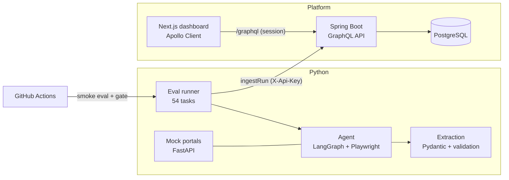
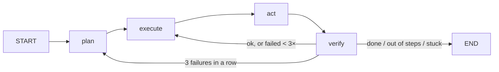

# AgentGate

An AI agent that processes invoices across messy vendor portals, and the evaluation platform that measures and
improves its reliability. The agent signs in to simulated vendor portals, downloads invoice PDFs, extracts and
validates the fields, and records them in an accounts-payable app. Every run is scored automatically, gated in
CI, and browsable step by step in a dashboard.

## Architecture



| Part | Stack | Where |
|---|---|---|
| Test environment | FastAPI, Jinja, reportlab | [`agentgate/portals`](agentgate/portals) |
| Agent | LangGraph, Playwright, OpenAI-compatible LLM layer | [`agentgate/agent`](agentgate/agent), [`agentgate/llm.py`](agentgate/llm.py) |
| Document extraction | Pydantic structured output, rule validation | [`agentgate/extraction`](agentgate/extraction) |
| Eval suite and CI gate | pytest, GitHub Actions | [`agentgate/suites`](agentgate/suites), [`agentgate/runner`](agentgate/runner), [`.github/workflows`](.github/workflows) |
| API | Spring Boot 4, Spring for GraphQL, JPA, Flyway, PostgreSQL | [`api`](api) |
| Dashboard | Next.js 16, React 19, TypeScript, Apollo Client 4, Jest | [`dashboard`](dashboard) |

## Quickstart

**Whole stack with Docker:** `docker compose up --build`, then open http://localhost:3000 (dev sign-in is on).

**Python only:**

```bash
make setup                                   # venv, dependencies, Playwright Chromium
make test                                    # 170+ tests, no API key needed
export GEMINI_API_KEY=...                    # free key from Google AI Studio
python -m agentgate run --smoke              # 6-task smoke run against the graph agent
python -m agentgate run --difficulty hard    # or a slice of the 54-task suite
python -m agentgate extract-eval --n 30      # extraction accuracy on clean + scanned PDFs
python -m agentgate report runs/*/results.json   # Markdown comparison table across runs
```

Any OpenAI-compatible provider works via `--model provider:model`: `gemini:…`, `ollama:…` (local), `groq:…`,
`openrouter:…`, `hf:…`.

**API and dashboard without Docker** (needs Java 21, Node 22, PostgreSQL):

```bash
createdb agentgate
cd api && DEV_LOGIN=true ./mvnw spring-boot:run          # http://localhost:8080
cd dashboard && npm install && npm run dev               # http://localhost:3000
```

Sign in, register an agent to get an API key, then publish runs:

```bash
export AGENTGATE_API_KEY=ag_...
python -m agentgate publish runs/<run-id>
```

## The test environment

Each task run gets an isolated environment from the portal admin API, generated from a seed. **Friction** is
toggled per environment:

| Toggle | What the agent faces | easy | medium | hard |
|---|---|:-:|:-:|:-:|
| `shuffle_layout` | Column order, labels ("Gross", "Pay By"), status wording, sort order | | ✓ | ✓ |
| `renamed_buttons` | "Sign in" → "Access account", "View" → "›", "Download PDF" → "Export"… | | ✓ | ✓ |
| `pagination` | Invoice list split into pages of 4–6 | | ✓ | ✓ |
| `popups` | Cookie banner on every page, survey modal over the invoice list | | ✓ | ✓ |
| `session_timeout` | Session expires after N page loads | | | ✓ |
| `scanned_pdf_rate` | Share of image-only PDFs: rotated, noisy, blurred, no text layer | 0 | 0.2 | 0.5 |

- **Data and presentation use separate randomness**, so the same seed gives identical invoices at every
  difficulty, and any change in success rate comes from friction alone.
- **Sessions expire by page loads, not time**, so slow and fast models hit the timeout at the same point.
- **PDFs are byte-for-byte deterministic**: three vendor templates (US, bilingual German/English, statement
  with a "previous balance" distractor) plus scanned variants.
- **The portal shows a summary only**: PO number, subtotal, tax and shipping are in the PDF, so the agent
  must download and extract it.

## The agent



- **plan:** the LLM writes a 3–8 step plan, or re-plans the remaining work after repeated failures (2× max).
- **execute:** the LLM picks one tool for the current step: `click`, `fill`, `navigate`, `go_back`,
  `read_page`, `download`, `extract_invoice`, `step_done`, `done`.
- **verify:** deterministic checks, no LLM call. Did the tool fail? Did an error alert appear (bad login,
  expired session, form validation)? Did a click change nothing? Failures are fed back as feedback.

A ReAct baseline (`--agent react`) uses the same tools, so comparisons measure the control loop only.

**Extraction** sends the PDF's text layer, or page images for scans, to the model with a Pydantic-derived JSON
schema. It then validates line math, totals, dates, the vendor master and the tax rate, and retries with the
failed checks as feedback. `extract-eval` reports per-field accuracy by template and clean/scanned, accuracy
before and after repair, and validator precision and recall.

## Evaluation and CI

- **54 tasks:** 6 kinds (lookups, counts, totals, data entry, find-oldest-and-enter) × 3 vendors × 3
  difficulties. Ground truth comes from the environment generator, and data-entry tasks score each AP field.
- **Metrics:** success rate (overall and per difficulty), field accuracy, steps, p50/p95 latency, tokens,
  cost per task, and failure reasons.
- **CI** ([`ci.yml`](.github/workflows/ci.yml)): Python, Java (against PostgreSQL), dashboard, and Docker
  builds on every push. On pull requests, the smoke subset runs against a real model and **fails the build if
  success drops** versus [`baselines/smoke.json`](baselines). Needs a `GEMINI_API_KEY` repository secret.

## Platform

- **API:** GraphQL schema in [`schema.graphqls`](api/src/main/resources/graphql/schema.graphqls). Agents get
  one-time API keys, stored as SHA-256 hashes, for ingest. People sign in with GitHub OAuth (or the opt-in
  dev login). Every query is scoped to the caller's own agents, so other users' data reads as "not found".
  Re-ingesting a run updates it in place. Screenshot storage is protected against path traversal.
- **Dashboard:** agents with their latest results, a success trend chart per agent, a run view with
  per-difficulty bars and failed-task filter, and a step-by-step replay of every task with the screenshot
  after each action and the verifier's feedback.

### GitHub OAuth

Create a GitHub OAuth App with callback `http://localhost:3000/login/oauth2/code/github`, then start the API with
`SPRING_PROFILES_ACTIVE=github GITHUB_CLIENT_ID=… GITHUB_CLIENT_SECRET=…`.

## Results

Numbers are produced by the commands above and added here as runs complete.

| Measurement | Result |
|---|---|
| Extraction, llama3.2 3B local, 6 clean PDFs | 100% on IDs, dates and PO numbers; 16.7% whole-document accuracy; validator flagged 6/6 wrong documents |
| Agent suite, Gemini | _pending_ |
| Extraction, Gemini, clean vs. scanned | _pending_ |

## Repository layout

```
agentgate/      Python package: portals, agent, extraction, suites, runner, LLM layer
api/            Spring Boot GraphQL API (Java 21)
dashboard/      Next.js dashboard (TypeScript)
tests/          pytest (unit, integration, browser)
baselines/      CI gate reference results
```

## Note for macOS + Python 3.13

The Makefile calls `python -m agentgate` from the repo root instead of the `agentgate` script. On some Macs,
files inside `.venv` get the hidden flag, and Python 3.13 skips hidden `.pth` files, which breaks editable
installs.
